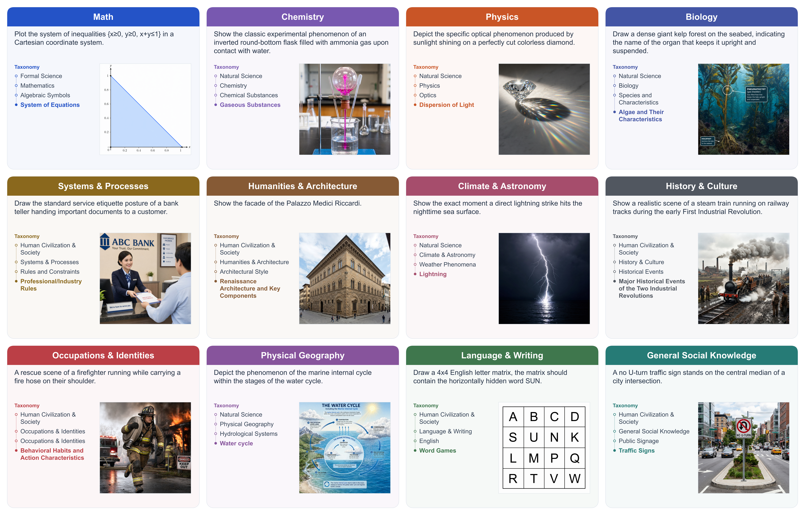
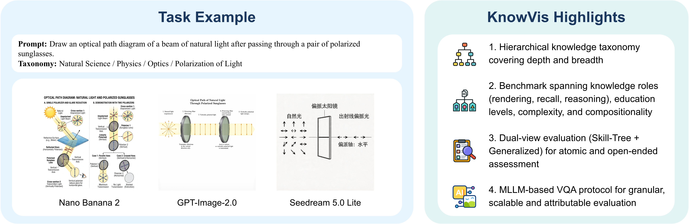
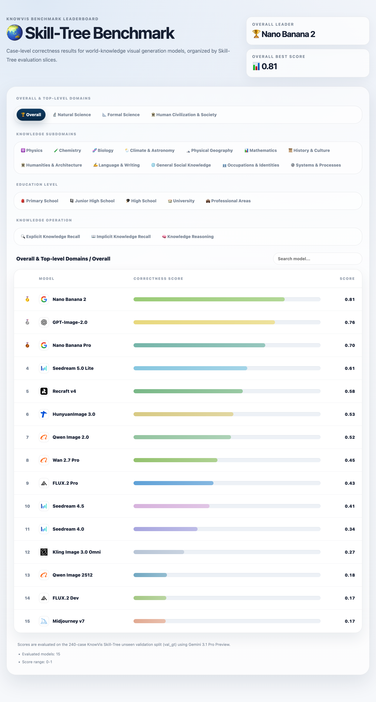
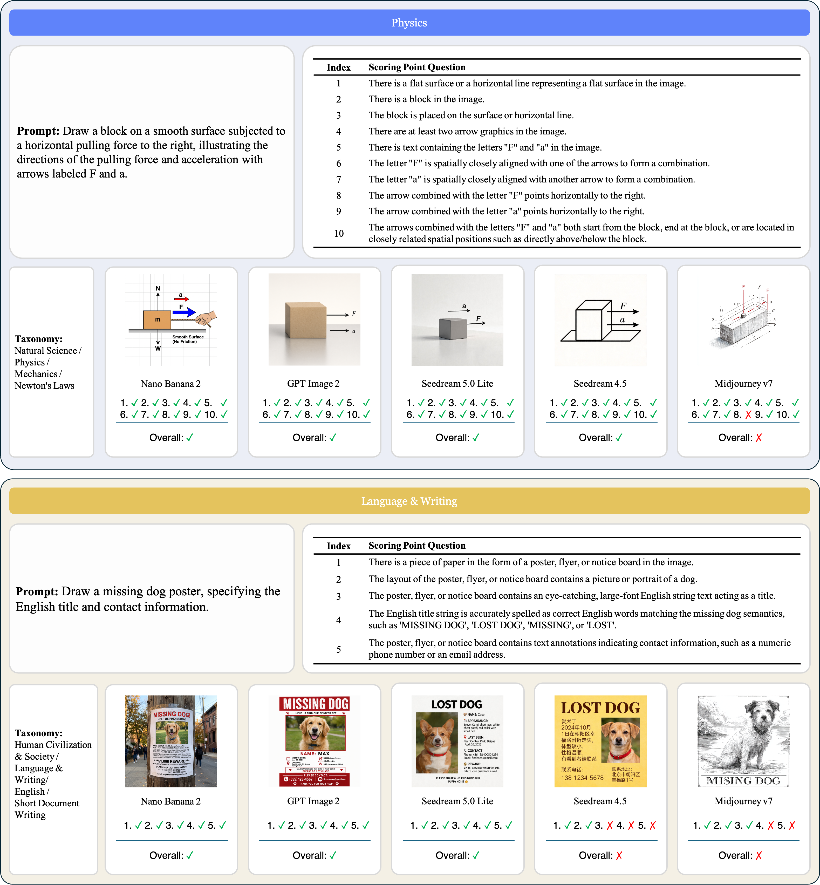

<div align="center">

# 🌏 KnowVis

## 文生图模型世界知识定位能力的双视角评测与诊断基准

Yonghang Yu\*, Ruoyu Wang\*, Haoyu Zhang, Lin Qi, Yawei Zhou, Changqian Yu

KlingAI Research

NeurIPS 2026 · Evaluations & Datasets Track

[English](README.md) | [简体中文](README-zh.md)

</div>

<div align="center">

  [](https://neurips.cc/virtual/2026/poster/139323)
  [](https://openreview.net/forum?id=XEkhbF0f6x)
  [](https://huggingface.co/datasets/QuantumWhisper42/KnowVis)
  [](https://github.com/QuantumWhisper42/KnowVis)
  [](#-排行榜)

</div>

<br/>

<div align="center">
  
</div>

<br/>

## 📖 概述

文生图（T2I）模型在视觉真实性、美学质量和指令跟随方面已取得显著进展。然而，现实世界中的提示词往往超越了显式的视觉描述，还要求模型具备隐式事实、结构化知识和领域常识的理解能力。现有评估工作主要聚焦于显式提示词与图像的语义对齐或特定知识子领域，缺乏对 T2I 模型世界知识定位能力的统一评测与诊断。

我们提出 **KnowVis**，用于对 T2I 生成中的世界知识定位能力进行双视角评测与诊断。KnowVis 基于层次化知识分类体系与样本级标注构建，将两个互补的基准视图与结构化的多模态大语言模型（MLLM）VQA 评判协议相结合：**技能树基准**（Skill-Tree Benchmark）支持细粒度的原子知识评估，**泛化基准**（Generalized Benchmark）考察开放式场景下的知识组合与表达。

该评判协议在技能树基准中使用必答 VQA（Required VQAs）评估原子知识正确性；在泛化基准中，则将必答项（Required）、选答项（Optional）以及动态发现的补充知识表达与人机协同评估相结合。我们在技能树验证划分上验证了该协议的可靠性，从而支持可扩展的自动化评测与诊断性错误归因。实验表明，KnowVis 揭示了现有 T2I 模型在世界知识定位上的显著差距，并为知识密集型图像生成提供了结构化的诊断信号。

| 基准视图 / 子集 | 发布全量样本数 | 实验 / 评测子集 | 知识分类覆盖范围 |
| :--- | :---: | :---: | :--- |
| **技能树基准** (`skill_tree`) | 1,622 | 480（`test_gt` 240 条可见开发集 + `val_gt` 240 条未见验证集） | 3 个 L1 领域 · 12 个 L2 学科 · 41 个 L3 分支 · 240 个 L4 原子知识点 |
| **泛化基准** (`generalized`) | 550 | 100 | 5 个 L1 领域 · 20 个 L2 学科 · 70 个 L3 分支 |
| **通用领域控制子集** (`common`) | 100 | 100（取自 600 条通用评测池） | 常见实体与场景生成 |

<div align="center">
  
</div>

## 🚀 排行榜

点击下方图片可按知识类目、教育阶段和知识作用方式查看详细排名。排行榜展示的是各模型在 **240 条技能树未见验证集（`val_gt`）** 上的样本级正确率（默认评测模型为 **Gemini 3.1 Pro Preview**）。

- **更新日志（`2026-11-10`）**：GitHub Pages 更换为新的项目主页。页面榜单和结果下载使用同一份 `docs/data/skill-tree.json`。
- **更新日志（`2026-11-06`）**：仓库更新为 camera-ready 版本。
- **更新日志（`2026-06-04`）**：在论文评测的 10 个模型（`Nano Banana 2`、`Seedream 5.0 Lite`、`Recraft v4`、`HunyuanImage 3.0`、`Qwen Image 2.0`、`Wan 2.7 Pro`、`FLUX.2 Pro`、`Seedream 4.5`、`Kling Image 3.0 Omni`、`Midjourney v7`）基础上，新增了 5 个扩展评测模型（`Nano Banana Pro`、`GPT-Image-2.0`、`FLUX.2 Dev`、`Qwen Image 2512`、`Seedream 4.0`）。

<div align="center">
  <a href="https://quantumwhisper42.github.io/KnowVis/">
    
  </a>
</div>

页面数据可由 judged checklist 直接生成或增量更新。一条 case 通过，当且仅当它的 REQUIRED VQA 里没有 FAIL。你可以自由指定任意模型子集进行对比，也可以传入新模型或通过 `--merge` 将新模型合并进现有排行榜 JSON 中参与排名：

```bash
# 对比任意模型子集（支持预设模型 key 或自定义模型名）：
python scripts/score_skill_tree.py \
  --dataset seed/data/skill_tree_en.jsonl \
  --judged nano_banana_2=path/to/judged_nano_banana_2.jsonl \
  --judged kling_image_3_0_omni=path/to/judged_kling.jsonl \
  --output docs/data/skill-tree.json

# 或将新评测的模型合并进现有 15 模型排行榜：
python scripts/score_skill_tree.py \
  --dataset seed/data/skill_tree_en.jsonl \
  --judged "My New Model=path/to/judged_my_model.jsonl" \
  --merge docs/data/skill-tree.json \
  --output docs/data/skill-tree.json
```

每个待对比的模型传一次 `--judged <key_or_name>=<jsonl>` 即可。`kling_image_3_0_omni` 对应 Kling Image 3.0 Omni。输出的是主页榜单读取、也是 “Download results JSON” 下载的同一份文件。这条命令只覆盖该 JSON，不会替换 `docs/index.html`。

## ℹ️ 项目简介

本项目是 [QuantumWhisper42/KnowVis](https://huggingface.co/datasets/QuantumWhisper42/KnowVis) 的配套代码，实现了一个四阶段评测框架：

1. **评测集生成和自动过滤** — 根据给定类目树生成世界知识文生图提示词。
2. **提示词分析** — 将 T2I 提示词分解为 VQA（视觉问答）核查单，识别需要验证的视觉元素。
3. **图像分析** — 根据实际生成的图像生成额外的 VQA 项，捕捉提示词分析未预见的失败情况。
4. **评判** — MLLM-as-a-Judge 模块，对每个 VQA 项给出判定（通过/不通过/不适用）及推理过程，输出结构化评测结果。

每个阶段以 **pydantic-graph** 工作流实现，支持基于 SQLite 的状态持久化，具备容错与可恢复执行能力。

## 📂 项目结构

```
.
├── data/template/                      # System Prompt 和 Message 模板
├── assets/readme/                      # 本 README 引用的配图
├── docs/                               # GitHub Pages 项目主页
├── leaderboard/                        # 独立排行榜页面，读取 docs/data/skill-tree.json，不作为站点首页发布
├── example/                            # 快速上手示例数据与图像
├── lib
│   ├── agents
│   │   ├── analysis
│   │   │   ├── image_analysis.py       # 图像 → 额外 VQA 流水线
│   │   │   └── prompt_analysis.py      # 提示词 → VQA 核查单流水线
│   │   ├── generate/generate_prompt.py # 提示词生成 + 筛选流水线
│   │   └── judge/judge_model_image.py  # MLLM-as-a-Judge VQA 评测
│   ├── models/                         # Pydantic 模型（VQA、评判等）
│   ├── tools/                          # 图像搜索工具
│   └── utils/                          # 工具函数
├── scripts/                            # 排行榜计分与标注一致率统计脚本
├── main.py                             # 入口
├── pyproject.toml                      # 依赖与项目配置
├── README-zh.md
├── README.md
└── uv.lock
```

## 👁️ 核心概念

### 🧐 VQA 核查单

评测的核心单元是 **VQA 核查单**——一组从提示词语义需求中拆解出的结构化视觉核查项：

- **组件类型**：`ENTITY`（实体）、`ENTITY_TRAIT`（实体特征）、`ATTRIBUTE_BINDING`（属性绑定）、`ENTITY_RELATION`（实体关系）、`ANNOTATION`（标注）、`ANNOTATION_BINDING`（标注绑定）、`ANNOTATION_RELATION`（标注关系）
- **评测类型**：`VISUAL`（世界知识视觉载体）、`KNOWLEDGE`（世界知识内容逻辑）、`INSTRUCTION`（非知识类基础视觉指令遵循，用于 `generalized` 模式）
- **判定类型**：`REQUIRED`（核心必答项）、`OPTIONAL`（预定义补充表达项，用于衡量知识丰富度）与 `ADDITIONAL`（阶段 3 动态发现的补充表达项）

### 📚 分类体系

- **L1**：一级领域
- **L2**：二级学科
- **L3**：三级分支
- **L4**：原子知识点及标注规则

### 🤖 评判模式

评判模块支持多种消融模式，用于受控实验：

| 模式 | 说明 |
|------|------|
| `baseline` | 完整流水线，包含标签、知识提示和视觉锚定 |
| `skip_label` | 移除分类体系标签上下文 |
| `skip_knowledge_hint` | 移除世界知识补充 |
| `skip_visual_grounding` | 移除参考图像证据 |
| `skip_all` | 移除所有外部上下文 |
| `general` | 通用评测模式 |

## 🗂️ 依赖

- **Python 3.13+**
- **pydantic-ai** + **pydantic-graph** — Agent 与图框架
- **Google Gemini**（Vertex AI）/ **OpenAI 兼容接口** — MLLM 后端
- **mwclient** — Wikimedia Commons API
- **minijinja** — 模板渲染

完整依赖列表见 `pyproject.toml`。

## 🤝 约定

- `task_name`: 代表一个数据合成和评测任务。`output/<task_name>/` 是一个任务的根目录。
- `images`: `output/<task_name>/images/` 目录下应包含所有用于评测的图像 assets。图像的文件名一定是 `{case_id}_{N}.png` 格式。N 为从 1 开始的正整数。如果文生图模型支持组图生成，那么应当按照顺序，从1开始编号，以得到更置信的评测结果。
- `case_id`: 用于唯一标识一个评测案例的标识符。

## 🔖 环境变量

- `WIKIMEDIA_COMMONS_USER_AGENT`: 参考 [Wikimedia Foundation User-Agent Policy](https://foundation.wikimedia.org/wiki/Policy:Wikimedia_Foundation_User-Agent_Policy), 提供符合要求的 User-Agent 字符串。
- `GOOGLE_APPLICATION_CREDENTIALS`: 指向 Google Cloud 凭据文件的路径，用于 Vertex AI 访问。
- `GOOGLE_CLOUD_PROJECT`: Google Cloud 项目 ID，用于 Vertex AI 访问。
- `GOOGLE_CLOUD_LOCATION`: Google Cloud 地区，用于 Vertex AI 访问。当前必须为 `global`，未来可能可选更多地区。

## 🚀 使用方法

> **流程指引：**
> - **在已发布的 KnowVis 基准上评测文生图模型**：执行步骤 **1 → 2 → 3（`seed`）**，将待评模型生成的图像放入 `output/<task_name>/images/`（或通过 `--image-s3-uri` 指定），然后直接跳至步骤 **7（`judge`）**。
> - **基于知识分类树从零合成自定义基准**：依次执行步骤 **1 → 2 → 3（`seed --kind=taxonomy`）→ 4（`generate-prompt`）→ 5（`analyze-prompt`）→ 6（`analyze-image`，可选）→ 7（`judge`）**。

1. **安装依赖**

本项目使用 uv 管理依赖。

```bash
uv sync
source .venv/bin/activate # 激活环境
```

2. **从 Hugging Face 下载全量数据集**

```bash
python main.py init # 默认从QuantumWhisper42/KnowVis下载
# 除此之外，还可以选择：
python main.py init --assets # 包含图像资产
python main.py init --repo-id=your-repo-id # 从其他仓库下载
python main.py init --repo-id=your-repo-id --repo-type=dataset # 指定仓库类型
```

3. **初始化任务**

```bash
python main.py seed <task_name> --language=<en|zh> --kind=<all|images|taxonomy|vqa_checklist|judge_performance> --split=<generalized|skill_tree> --judge-performance-split=<test|val> --source=<hf|example>
```

说明：
- `task_name`：任务名称，将被创建在 `output/<task_name>` 目录下
- `language`：语言，支持 `en` 和 `zh`。默认为 `en`
- `kind`：种子类型，支持 `all`、`images`、`taxonomy`、`vqa_checklist`、`judge_performance`
  - `all`: 自动初始化所有类型的数据（未显式指定时默认 `split=skill_tree`、`judge_performance_split=val`）。
  - `images`: 种子化图像。从 `source` 复制 `assets` 目录下的文件，到 `output/<task_name>/images` 目录下，用于人机一致性验证。
  - `taxonomy`: 种子化分类体系。从 `source` 复制 `taxonomy_tree.json` 文件到 `output/<task_name>/taxonomy_tree.json`。
  - `vqa_checklist`: 种子化 VQA 核查单。从 `source` 复制 `data/{split}_{language}.jsonl` 文件到 `output/<task_name>/vqa_checklist_{language}.jsonl`。
  - `judge_performance`: 种子化带人工真值与补充项的 VQA 核查单。从 `source` 复制 `data/{judge_performance_split}_gt_{language}.jsonl` 文件到 `output/<task_name>/additional_vqa_checklist_{language}.jsonl`，用于人机一致性验证。
- `split`：VQA 核查单划分方式，支持 `generalized` 和 `skill_tree`
- `judge_performance_split`：评测性能数据划分方式，支持 `test`（对应论文 240 条可见开发集 `test_gt`）和 `val`（对应论文 240 条未见验证集 `val_gt`，用于最终模型评测与排行榜排名）
- `source`：源类型，支持 `hf` 和 `example`

> 如果选择 `source=example`，则会从 `example/` 目录下复制文件，而不会从 Hugging Face 下载。*适用于快速上手和演示*
> 我们强烈建议先从 `source=example` 开始测试，再从 `source=hf` 获取真实数据进行评测。

4. **运行阶段 1：评测集生成和自动过滤**

当 `output/<task_name>/taxonomy_tree.json` 存在时，即可运行阶段 1。

```bash
python main.py generate-prompt <task_name> --language=<en|zh> --size=<int>
```

说明：
- `task_name`：任务名称
- `language`：语言，支持 `en` 和 `zh`。默认为 `en`
- `size`：每个分类下生成的 prompt 数量。默认为 10

执行完成后，生成的 prompt 将被保存在 `output/<task_name>/generated_prompt_{language}.jsonl` 文件中。

5. **运行阶段 2：VQA 核查单拆解**

当 `output/<task_name>/generated_prompt_{language}.jsonl` 存在时，即可运行阶段 2。

```bash
python main.py analyze-prompt <task_name> --language=<en|zh> --mode=<skill_tree|general>
```

说明：
- `task_name`：任务名称
- `language`：语言，支持 `en` 和 `zh`。默认为 `en`
- `mode`：拆解模式，支持 `skill_tree` 和 `general`。默认为 `skill_tree`。 `general` 模式下，会额外添加非知识类基础视觉指令遵循的 VQA checklist 拆解

执行完成后，生成的 VQA checklist 将被保存在 `output/<task_name>/vqa_checklist_{language}.jsonl` 文件中。

6. **运行阶段 3：额外 VQA 核查单生成**

这一步为可选项，用于从实际生成的图像中动态提取预定义 `OPTIONAL` 池之外、由模型自发生成的补充知识表达（`ADDITIONAL` VQA），以支持细粒度归因分析与选答池迭代扩充。

当 `output/<task_name>/vqa_checklist_{language}.jsonl` 存在，且 `images/` 目录下存在所有 case 的图像文件时，即可运行阶段 3。

```bash
python main.py analyze-image <task_name> --language=<en|zh>
```

说明：
- `task_name`：任务名称
- `language`：语言，支持 `en` 和 `zh`。默认为 `en`

执行完成后，生成的额外 VQA 核查单将被保存在 `output/<task_name>/additional_vqa_checklist_{language}.jsonl` 文件中。

7. **运行阶段 4：MLLM 评判**

当 `output/<task_name>/vqa_checklist_{language}.jsonl` 或者 `output/<task_name>/additional_vqa_checklist_{language}.jsonl` 存在时，即可运行阶段 4。

```bash
python main.py judge <task_name> --language=<en|zh> --use-additional=<true|false> --mode=<baseline|skip_label|skip_knowledge_hint|skip_visual_grounding|skip_all|general> --model-config=<path> --image-s3-uri=<uri> --s3-endpoint-url=<url> --no-sign-request
```

说明：
- `task_name`：任务名称
- `language`：语言，支持 `en` 和 `zh`。默认为 `en`
- `use_additional`：是否使用额外的 VQA checklist。默认为 `false`
- `mode`：评测模式。用于消融实验以及区分技能树基准和泛化基准，支持 `baseline`、`skip_label`、`skip_knowledge_hint`、`skip_visual_grounding`、`skip_all` 和 `general`。默认为 `baseline`
- `model_config`：评测模型配置文件（JSON）路径，见下方[评测模型配置](#-评测模型配置)。不传时使用 `gemini-3.1-pro-preview`
- `image_s3_uri`：`s3://<bucket>/<key-template>`，见下方[图片来源](#-图片来源)。不传时从 `output/<task_name>/images` 读取
- `s3_endpoint_url`：该 bucket 的 endpoint，需要带上 `http://` 或 `https://`。会覆盖 `AWS_ENDPOINT_URL` 和 `AWS_ENDPOINT_URL_S3`
- `no_sign_request`：S3 请求不签名。`AWS_NO_SIGN_REQUEST=true` 效果相同

找不到图片的 case 会被跳过，而不会让整轮评测失败。结果保存在 `output/<task_name>/judged_vqa_checklist_{language}_{model}.jsonl`。使用 S3 来源时，文件名还会附上 bucket 和 key 前缀。

### 🗂 图片来源

默认从 `output/<task_name>/images` 读取，文件名形如 `<case_id>_<index>.png`。

`--image-s3-uri` 改为读取 S3 兼容的 bucket。URI 里只有 bucket 和 key 模板：

```bash
python main.py judge <task_name> --image-s3-uri="s3://<bucket>/<key-prefix>/{case_id}_{index}.png"
```

endpoint 另外给：

- 环境变量 `AWS_ENDPOINT_URL` 或 `AWS_ENDPOINT_URL_S3`，值里要带 `http://` 或 `https://`。
- `--s3-endpoint-url` 会覆盖这两个变量。

不传这个参数时，客户端不会显式传入 `endpoint_url`，所以上面的环境变量仍然生效。传空字符串会把它们清掉。

签名默认走 boto 的 SigV4 凭证链：`AWS_ACCESS_KEY_ID` 和 `AWS_SECRET_ACCESS_KEY`、`~/.aws/credentials`，或实例角色。匿名读需要显式打开：

```bash
python main.py judge <task_name> --image-s3-uri="s3://<bucket>/<key-prefix>/{case_id}_{index}.png" --no-sign-request
```

`AWS_NO_SIGN_REQUEST=true` 等价。boto3 不读这个变量，`~/.aws/config` 里也没有 `signature_version`，所以只有这个参数或这个变量会关闭签名。

代码不写死 `addressing_style`。boto3 会读 `~/.aws/config` 的 `s3.addressing_style`（`path`、`virtual` 或 `auto`）。设置了自定义 endpoint 时，除非这项写成 `virtual`，botocore 默认就是 path-style：

```ini
[default]
s3 =
    addressing_style = path
```

`{index}` 不是猜出来的：程序按前缀列出 key，再按数字排序。每张图的 md5 会写进断点续跑的 run id。S3 上这个哈希来自对象的 `ETag`。

### 🔧 评测模型配置

`--model-config` 指向一个 JSON 文件，用于选择评测模型，并可选地把请求路由到自定义 LLM 网关：

| 字段 | 说明 |
|------|------|
| `provider` | `google` 或 `openai` |
| `model` | 模型 ID，例如 `gemini-3.1-pro-preview` |
| `entrypoint` | 可选。网关地址，原样使用。不填则走第一方接口 |
| `headers` | 可选。网关鉴权用的请求头 |
| `reasoning_effort` | 可选，仅 `openai` 使用。`low`、`medium`、`high`，或 `null`。默认 `high` |
| `output_mode` | 可选。`tool`、`native` 或 `prompted`。`google` 默认 `tool`，`openai` 默认 `native` |

`entrypoint` 需要写完整：

- `google`：包含完整资源前缀。SDK 只会在其后追加 `publishers/google/models/<model>:generateContent`。不能以 `.googleapis.com` 结尾，否则 SDK 会回退到 Application Default Credentials 而不使用 `headers`
- `openai`：写到 `/chat/completions` 之前的部分

```json
{
  "provider": "openai",
  "model": "gpt-5.5",
  "entrypoint": "https://<gateway>/v1",
  "headers": { "Authorization": "..." },
  "reasoning_effort": "high"
}
```

### 📏 标注一致率

`scripts/agreement.py` 比较同一批 case 的两份标注，报告准确率、Cohen's kappa 和混淆矩阵。任意一侧都可以是人类标注、某个 judge，或同一 judge 配置隔一段时间后的另一次运行：

- judge 对人类标注
- 两个人类标注
- 两个不同的 judge 配置
- 同一个配置的两次运行

`--gt` 是参考侧，`--pred` 是被比较的一侧。两边都是 jsonl，每条的标签字段是 `judgment`。脚本不负责定时重跑。默认参考文件是 `seed/data/test_gt_zh.jsonl`（240 条可见开发集）和 `seed/data/val_gt_zh.jsonl`（240 条未见验证集），默认报告是 `stat/agreement.json`。


## 🖼 VQA 检查项示例

<div align="center">
  
</div>


## 📜 许可证

本仓库代码基于 MIT 许可证开源（Copyright (c) 2026 KlingAI Research），请参阅 [LICENSE](LICENSE) 文件获取详细信息。KnowVis 基准数据集采用 [知识共享署名 4.0 国际许可协议（CC BY 4.0）](https://creativecommons.org/licenses/by/4.0/) 授权。

---

## 🤝 贡献

欢迎反馈与贡献。如发现问题或有改进建议，请提交 Issue。

## 📚 引用

```bibtex
@inproceedings{knowvis2026,
  title = {KnowVis: Dual-View Evaluation and Diagnosis of
           World-Knowledge Grounding in Text-to-Image Models},
  author = {Yu, Yonghang and Wang, Ruoyu and Zhang, Haoyu and Qi, Lin and Zhou, Yawei and Yu, Changqian},
  booktitle = {Advances in Neural Information Processing Systems},
  year = {2026},
  url = {https://neurips.cc/virtual/2026/poster/139323}
}
```
