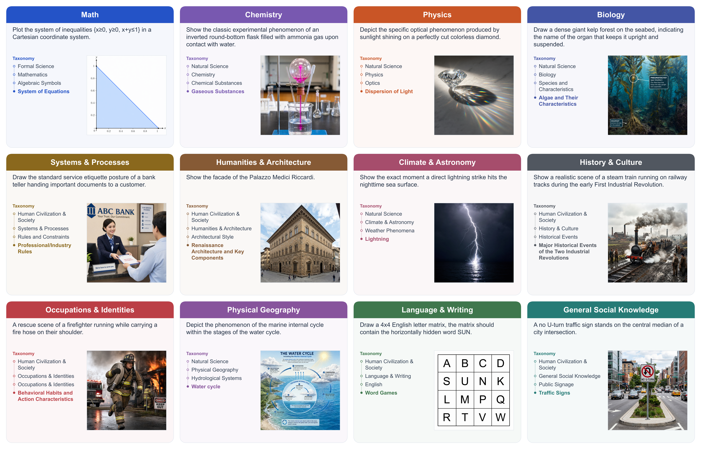
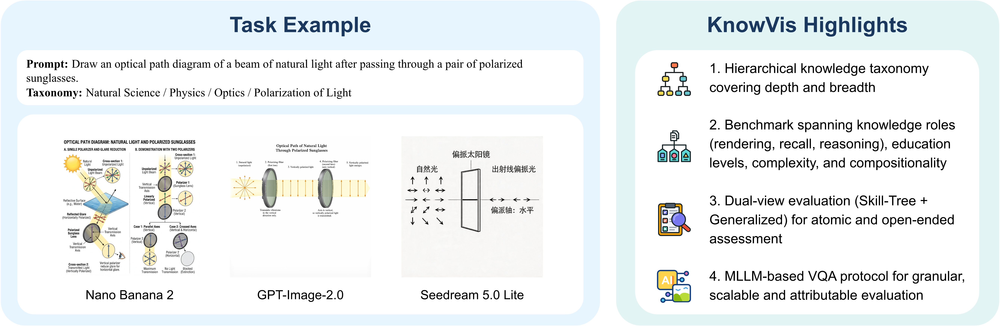
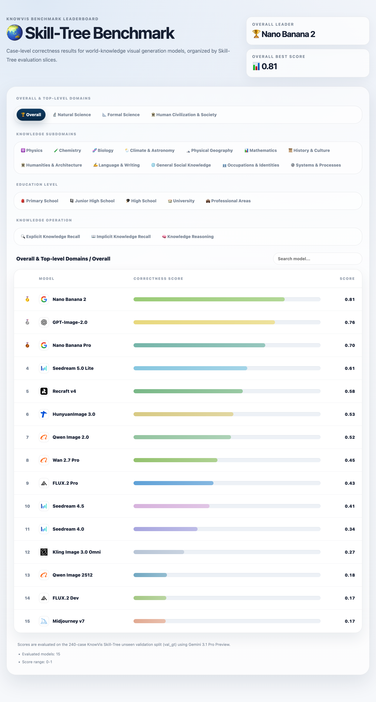
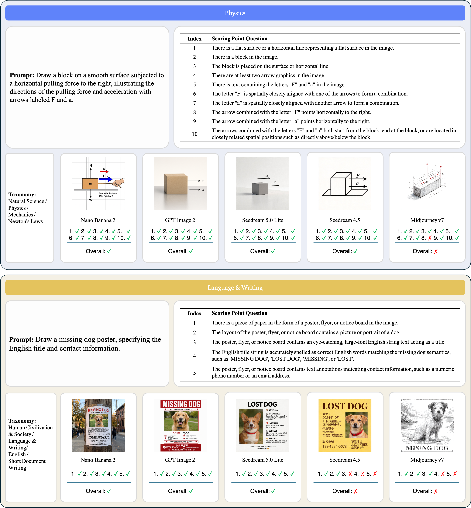

<div align="center">

# 🌏 KnowVis

## Dual-View Evaluation and Diagnosis of World-Knowledge Grounding in Text-to-Image Models

Yonghang Yu\*, Ruoyu Wang\*, Haoyu Zhang, Lin Qi, Yawei Zhou, Changqian Yu

KlingAI Research

NeurIPS 2026 · Evaluations & Datasets Track

[English](README.md) | [简体中文](README-zh.md)

</div>

<div align="center">

  [](https://neurips.cc/virtual/2026/poster/139323)
  [](https://openreview.net/forum?id=XEkhbF0f6x)
  [](https://huggingface.co/datasets/QuantumWhisper42/KnowVis)
  [](https://github.com/QuantumWhisper42/KnowVis)
  [](#-leaderboard)

</div>

<br/>

<div align="center">
  
</div>

<br/>

## 📖 Overview

Text-to-image (T2I) models have made substantial progress in visual realism, aesthetic quality, and instruction following. However, real-world prompts often go beyond explicit visual descriptions and require implicit facts, structured knowledge, and domain-specific commonsense. Existing evaluations mainly focus on explicit prompt-to-image semantic alignment or specific knowledge subdomains, lacking unified evaluation and diagnosis of world-knowledge grounding in T2I models.

We introduce **KnowVis** for dual-view evaluation and diagnosis of world-knowledge grounding in T2I generation. Built on a hierarchical knowledge taxonomy with case-level annotations, KnowVis combines two complementary benchmark views with a structured MLLM-based VQA judge protocol. The **Skill-Tree Benchmark** supports fine-grained atomic knowledge evaluation, while the **Generalized Benchmark** examines open-ended knowledge composition and expression.

The protocol uses Required VQAs to assess atomic knowledge correctness in the Skill-Tree Benchmark, and combines Required, Optional, and dynamically discovered knowledge expressions with human–judge collaborative evaluation in the Generalized Benchmark. We validate the protocol's reliability on the Skill-Tree validation split, enabling scalable evaluation and diagnostic error attribution. Experiments show that KnowVis reveals notable gaps in world-knowledge grounding across existing T2I models and provides structured diagnostic signals for knowledge-intensive image generation.

| Benchmark View / Subset | Full Released Cases | Experimental / Evaluation Subset | Taxonomy Coverage |
| :--- | :---: | :---: | :--- |
| **Skill-Tree Benchmark** (`skill_tree`) | 1,622 | 480 (`240` visible development in `test_gt` + `240` unseen validation in `val_gt`) | 3 L1 domains · 12 L2 subjects · 41 L3 branches · 240 L4 atomic points |
| **Generalized Benchmark** (`generalized`) | 550 | 100 | 5 L1 domains · 20 L2 subjects · 70 L3 branches |
| **General-Domain T2I Control** (`common`) | 100 | 100 (control subset from a 600-case pool) | Common entity and scene generation |

<div align="center">
  
</div>

## 🚀 Leaderboard

Click the image to view rankings by category, education level, and knowledge operation type. Leaderboard scores report case-level correctness on the **240-case Skill-Tree unseen validation split (`val_gt`)** evaluated by **Gemini 3.1 Pro Preview**.

- **Changelog (`2026-11-10`)**: Replaced the GitHub Pages site with the new project homepage. The page leaderboard and the results download both use `docs/data/skill-tree.json`.
- **Changelog (`2026-11-06`)**: Updated the repository to the camera-ready version.
- **Changelog (`2026-06-04`)**: Expanded the Skill-Tree Leaderboard with 5 additional models (`Nano Banana Pro`, `GPT-Image-2.0`, `FLUX.2 Dev`, `Qwen Image 2512`, and `Seedream 4.0`) alongside the 10 models evaluated in the paper (`Nano Banana 2`, `Seedream 5.0 Lite`, `Recraft v4`, `HunyuanImage 3.0`, `Qwen Image 2.0`, `Wan 2.7 Pro`, `FLUX.2 Pro`, `Seedream 4.5`, `Kling Image 3.0 Omni`, and `Midjourney v7`).

<div align="center">
  <a href="https://quantumwhisper42.github.io/KnowVis/">
    
  </a>
</div>

Rebuild or update the leaderboard data from judged checklists. A case passes when none of its REQUIRED VQA items is FAIL. You can compare any subset of models, register new models on the fly, or use `--merge` to insert new models into the existing leaderboard JSON:

```bash
# Score any set of models (known keys or custom model names):
python scripts/score_skill_tree.py \
  --dataset seed/data/skill_tree_en.jsonl \
  --judged nano_banana_2=path/to/judged_nano_banana_2.jsonl \
  --judged kling_image_3_0_omni=path/to/judged_kling.jsonl \
  --output docs/data/skill-tree.json

# Or merge a newly evaluated model into the existing 15-model leaderboard:
python scripts/score_skill_tree.py \
  --dataset seed/data/skill_tree_en.jsonl \
  --judged "My New Model=path/to/judged_my_model.jsonl" \
  --merge docs/data/skill-tree.json \
  --output docs/data/skill-tree.json
```

Pass `--judged <key_or_name>=<jsonl>` once for each model you want to evaluate or compare. `kling_image_3_0_omni` is Kling Image 3.0 Omni. The output file is the one the homepage leaderboard fetches and the one offered as “Download results JSON”. The command overwrites that JSON only and does not replace `docs/index.html`.

## ℹ️ Project Overview

This repository is the official companion codebase for [QuantumWhisper42/KnowVis](https://huggingface.co/datasets/QuantumWhisper42/KnowVis) and implements a four-stage evaluation framework:

1. **Benchmark generation and automatic filtering** — Generates world-knowledge T2I prompts from a given taxonomy tree.
2. **Prompt analysis** — Decomposes T2I prompts into VQA checklists that identify visual elements requiring verification.
3. **Image analysis** — Generates additional VQA items from the actual generated images, capturing failure modes not anticipated during prompt analysis.
4. **Judging** — An MLLM-as-a-judge module that produces pass/fail/N.A. verdicts with reasoning for each VQA item, outputting structured evaluation results.

Each stage is implemented as a **pydantic-graph** workflow with SQLite-based state persistence, supporting fault-tolerant and resumable execution.

## 📂 Project Structure

```
.
├── data/template/                      # System prompt and message templates
├── assets/readme/                      # Figures embedded in this README
├── docs/                               # GitHub Pages project homepage
├── leaderboard/                        # Standalone leaderboard page; reads docs/data/skill-tree.json and is not the site root
├── example/                            # Quick-start example cases and assets
├── lib
│   ├── agents
│   │   ├── analysis
│   │   │   ├── image_analysis.py       # Image → additional VQA pipeline
│   │   │   └── prompt_analysis.py      # Prompt → VQA checklist pipeline
│   │   ├── generate/generate_prompt.py # Prompt generation + filtering pipeline
│   │   └── judge/judge_model_image.py  # MLLM-as-a-judge VQA evaluation
│   ├── models/                         # Pydantic models (VQA, judgments, etc.)
│   ├── tools/                          # Image search tools
│   └── utils/                          # Utility functions
├── scripts/                            # Leaderboard scoring and agreement scripts
├── main.py                             # Entry point
├── pyproject.toml                      # Dependencies and project configuration
├── README-zh.md
├── README.md
└── uv.lock
```

## 👁️ Core Concepts

### 🧐 VQA Checklist

The core evaluation unit is the **VQA checklist** — a set of structured visual verification items extracted from the semantic requirements of a prompt:

- **Component types**: `ENTITY`, `ENTITY_TRAIT`, `ATTRIBUTE_BINDING`, `ENTITY_RELATION`, `ANNOTATION`, `ANNOTATION_BINDING`, `ANNOTATION_RELATION`
- **Evaluation types**: `VISUAL` (world-knowledge visual carrier), `KNOWLEDGE` (world-knowledge content logic), `INSTRUCTION` (non-knowledge visual instruction following, used in `generalized` mode)
- **Judge types**: `REQUIRED` (core knowledge constraints), `OPTIONAL` (predefined supplementary expressions for knowledge richness), and `ADDITIONAL` (dynamically discovered supplementary expressions from Stage 3)

### 📚 Taxonomy

- **L1**: Top-level domain
- **L2**: Subject
- **L3**: Branch
- **L4**: Atomic knowledge point and annotation rules

### 🤖 Judge Modes

The judge module supports multiple ablation modes for controlled experiments:

| Mode | Description |
|------|-------------|
| `baseline` | Full pipeline with taxonomy labels, knowledge hints, and grounding evidence |
| `skip_label` | Removes taxonomy label context |
| `skip_knowledge_hint` | Removes world-knowledge hints |
| `skip_visual_grounding` | Removes reference image grounding evidence |
| `skip_all` | Removes all external context |
| `general` | General evaluation mode |

## 🗂️ Dependencies

- **Python 3.13+**
- **pydantic-ai** + **pydantic-graph** — Agent and graph framework
- **Google Gemini** (Vertex AI) / **OpenAI-compatible APIs** — MLLM backend
- **mwclient** — Wikimedia Commons API
- **minijinja** — Template rendering

See `pyproject.toml` for the full dependency list.

## 🤝 Conventions

- `task_name`: Represents a data synthesis and evaluation task. `output/<task_name>/` is the root directory for a task.
- `images`: The `output/<task_name>/images/` directory should contain all image assets used for evaluation. Image filenames must follow the format `{case_id}_{N}.png`, where N is a positive integer starting from 1. If the T2I model supports batch image generation, images should be numbered sequentially from 1 to obtain more reliable evaluation results.
- `case_id`: Unique identifier for an evaluation case.

## 🔖 Environment Variables

- `WIKIMEDIA_COMMONS_USER_AGENT`: Provide a compliant User-Agent string as required by the [Wikimedia Foundation User-Agent Policy](https://foundation.wikimedia.org/wiki/Policy:Wikimedia_Foundation_User-Agent_Policy).
- `GOOGLE_APPLICATION_CREDENTIALS`: Path to the Google Cloud credentials file for Vertex AI access.
- `GOOGLE_CLOUD_PROJECT`: Google Cloud project ID for Vertex AI access.
- `GOOGLE_CLOUD_LOCATION`: Google Cloud region for Vertex AI access. Currently must be set to `global`; additional regions may be supported in the future.

## 🚀 Usage

> **Workflow guide:**
> - **Evaluate T2I models on the released KnowVis benchmark:** Run Steps **1 → 2 → 3 (`seed`)**, place your generated images in `output/<task_name>/images/` (or pass `--image-s3-uri`), and jump directly to Step **7 (`judge`)**.
> - **Synthesize a custom benchmark from a taxonomy tree:** Run Steps **1 → 2 → 3 (`seed --kind=taxonomy`) → 4 (`generate-prompt`) → 5 (`analyze-prompt`) → 6 (`analyze-image`, optional) → 7 (`judge`)**.

1. **Install dependencies**

This project uses uv for dependency management.

```bash
uv sync
source .venv/bin/activate # Activate environment
```

2. **Download the full dataset from Hugging Face**

```bash
python main.py init # Downloads from QuantumWhisper42/KnowVis by default
# Additional options:
python main.py init --assets # Include image assets
python main.py init --repo-id=your-repo-id # Download from a different repository
python main.py init --repo-id=your-repo-id --repo-type=dataset # Specify repository type
```

3. **Initialize a task**

```bash
python main.py seed <task_name> --language=<en|zh> --kind=<all|images|taxonomy|vqa_checklist|judge_performance> --split=<generalized|skill_tree> --judge-performance-split=<test|val> --source=<hf|example>
```

Parameters:
- `task_name`: Task name. A directory will be created at `output/<task_name>`.
- `language`: Language; supports `en` and `zh`. Default: `en`.
- `kind`: Seed type; supports `all`, `images`, `taxonomy`, `vqa_checklist`, and `judge_performance`.
  - `all`: Automatically seeds all types (defaults to `split=skill_tree` and `judge_performance_split=val` when omitted).
  - `images`: Seeds image assets. Copies files from the `assets` directory of `source` to `output/<task_name>/images`, used for human-judge agreement validation.
  - `taxonomy`: Seeds the taxonomy. Copies `taxonomy_tree.json` from `source` to `output/<task_name>/taxonomy_tree.json`.
  - `vqa_checklist`: Seeds the VQA checklist. Copies `data/{split}_{language}.jsonl` from `source` to `output/<task_name>/vqa_checklist_{language}.jsonl`.
  - `judge_performance`: Seeds the ground-truth VQA checklist with additional items. Copies `data/{judge_performance_split}_gt_{language}.jsonl` from `source` to `output/<task_name>/additional_vqa_checklist_{language}.jsonl`, used for human-judge agreement validation.
- `split`: VQA checklist split; supports `generalized` and `skill_tree`.
- `judge_performance_split`: Judge performance data split; supports `test` (the 240-case visible development split `test_gt`) and `val` (the 240-case unseen validation split `val_gt` used for final model evaluation and leaderboard ranking).
- `source`: Source type; supports `hf` and `example`.

> If `source=example` is selected, files are copied from the `example/` directory rather than downloaded from Hugging Face. *Suitable for quick-start and demonstration purposes.*
> We strongly recommend first testing with `source=example` before switching to `source=hf` for evaluation on the full dataset.

4. **Run Stage 1: Benchmark generation and automatic filtering**

This stage requires `output/<task_name>/taxonomy_tree.json` to exist.

```bash
python main.py generate-prompt <task_name> --language=<en|zh> --size=<int>
```

Parameters:
- `task_name`: Task name.
- `language`: Language; supports `en` and `zh`. Default: `en`.
- `size`: Number of prompts to generate per category. Default: 10.

Upon completion, generated prompts are saved to `output/<task_name>/generated_prompt_{language}.jsonl`.

5. **Run Stage 2: VQA checklist decomposition**

This stage requires `output/<task_name>/generated_prompt_{language}.jsonl` to exist.

```bash
python main.py analyze-prompt <task_name> --language=<en|zh> --mode=<skill_tree|general>
```

Parameters:
- `task_name`: Task name.
- `language`: Language; supports `en` and `zh`. Default: `en`.
- `mode`: Decomposition mode; supports `skill_tree` and `general`. Default: `skill_tree`. In `general` mode, VQA checklist decomposition additionally covers non-knowledge basic visual instruction following.

Upon completion, generated VQA checklists are saved to `output/<task_name>/vqa_checklist_{language}.jsonl`.

6. **Run Stage 3: Additional VQA checklist generation**

This stage is optional. It dynamically extracts `ADDITIONAL` VQA items for valid supplementary knowledge expressions spontaneously produced in the generated images beyond the predefined `OPTIONAL` pool, supporting fine-grained analysis and iterative checklist refinement.

This stage requires `output/<task_name>/vqa_checklist_{language}.jsonl` to exist and image files for all cases to be present in the `images/` directory.

```bash
python main.py analyze-image <task_name> --language=<en|zh>
```

Parameters:
- `task_name`: Task name.
- `language`: Language; supports `en` and `zh`. Default: `en`.

Upon completion, results are saved to `output/<task_name>/additional_vqa_checklist_{language}.jsonl`.

7. **Run Stage 4: Evaluation**

This stage requires either `output/<task_name>/vqa_checklist_{language}.jsonl` or `output/<task_name>/additional_vqa_checklist_{language}.jsonl` to exist.

```bash
python main.py judge <task_name> --language=<en|zh> --use-additional=<true|false> --mode=<baseline|skip_label|skip_knowledge_hint|skip_visual_grounding|skip_all|general> --model-config=<path> --image-s3-uri=<uri> --s3-endpoint-url=<url> --no-sign-request
```

Parameters:
- `task_name`: Task name.
- `language`: Language; supports `en` and `zh`. Default: `en`.
- `use_additional`: Whether to use the additional VQA checklist. Default: `false`.
- `mode`: Evaluation mode. Used for ablation studies and to distinguish between the Skill-Tree Benchmark and the Generalized Benchmark. Supports `baseline`, `skip_label`, `skip_knowledge_hint`, `skip_visual_grounding`, `skip_all`, and `general`. Default: `baseline`.
- `model_config`: Path to a judge model configuration file (JSON); see [Judge Model Configuration](#-judge-model-configuration). Defaults to `gemini-3.1-pro-preview`.
- `image_s3_uri`: `s3://<bucket>/<key-template>` for an S3-compatible store; see [Image Sources](#-image-sources). Omit it to read `output/<task_name>/images`.
- `s3_endpoint_url`: Endpoint for that bucket, including `http://` or `https://`. Overrides `AWS_ENDPOINT_URL` and `AWS_ENDPOINT_URL_S3`.
- `no_sign_request`: Send unsigned S3 requests. `AWS_NO_SIGN_REQUEST=true` does the same.

Cases whose images cannot be found are skipped instead of failing the run. Results are saved to `output/<task_name>/judged_vqa_checklist_{language}_{model}.jsonl`. An S3 source also appends its bucket and key prefix to that filename.

### 🗂 Image Sources

By default the judged images are read from `output/<task_name>/images`, where every file is named `<case_id>_<index>.png`.

`--image-s3-uri` reads an S3-compatible bucket. The URI is only the bucket and the key template:

```bash
python main.py judge <task_name> --image-s3-uri="s3://<bucket>/<key-prefix>/{case_id}_{index}.png"
```

The endpoint is separate:

- `AWS_ENDPOINT_URL` or `AWS_ENDPOINT_URL_S3`. Include `http://` or `https://` in the value.
- `--s3-endpoint-url` overrides both.

When the flag is omitted, the client is created without `endpoint_url`, so those environment variables stay in effect. Passing an empty endpoint would clear them.

Signing uses boto's SigV4 credential chain: `AWS_ACCESS_KEY_ID` and `AWS_SECRET_ACCESS_KEY`, `~/.aws/credentials`, or an instance role. Anonymous reads are off unless you ask for them:

```bash
python main.py judge <task_name> --image-s3-uri="s3://<bucket>/<key-prefix>/{case_id}_{index}.png" --no-sign-request
```

`AWS_NO_SIGN_REQUEST=true` is equivalent. boto3 does not read that variable, and `~/.aws/config` has no `signature_version` key, so unsigned requests are enabled only by this flag or this variable.

`addressing_style` is not hardcoded. boto3 reads `s3.addressing_style` from `~/.aws/config` (`path`, `virtual`, or `auto`). With a custom endpoint, botocore already uses path-style unless that setting is `virtual`:

```ini
[default]
s3 =
    addressing_style = path
```

`{index}` is not guessed: keys are listed by prefix and sorted numerically. The md5 of each image is part of the resumable run id. For S3 that hash is the object's `ETag`.

### 🔧 Judge Model Configuration

`--model-config` points at a JSON file that selects the judge model and, optionally, routes requests through a custom LLM gateway:

| Field | Description |
|-------|-------------|
| `provider` | `google` or `openai` |
| `model` | Model id, e.g. `gemini-3.1-pro-preview` |
| `entrypoint` | Optional gateway URL, used verbatim. Omit it to use the first-party endpoint |
| `headers` | Optional gateway authentication headers |
| `reasoning_effort` | Optional, `openai` only. `low`, `medium`, `high`, or `null`. Default: `high` |
| `output_mode` | Optional. `tool`, `native`, or `prompted`. Defaults to `tool` for `google` and `native` for `openai` |

`entrypoint` must already be complete:

- `google`: include the full resource prefix. The SDK only appends `publishers/google/models/<model>:generateContent`. The URL must not end with `.googleapis.com`, or the SDK falls back to Application Default Credentials and ignores `headers`.
- `openai`: everything before `/chat/completions`.

```json
{
  "provider": "openai",
  "model": "gpt-5.5",
  "entrypoint": "https://<gateway>/v1",
  "headers": { "Authorization": "..." },
  "reasoning_effort": "high"
}
```

### 📏 Agreement

`scripts/agreement.py` compares two labelings of the same cases and reports accuracy, Cohen's kappa, and a confusion matrix. Either file can be a human annotator, a judge, or a later run of the same judge configuration:

- a judge against a human labeling
- two human annotators
- two judge configurations
- two runs of one configuration at different times

`--gt` is the reference side and `--pred` is the side being compared. Both are jsonl dumps, and every item's label is `judgment`. The script does not schedule a rerun. The default reference files are `seed/data/test_gt_zh.jsonl` (240 visible development cases) and `seed/data/val_gt_zh.jsonl` (240 unseen validation cases), and the default report is `stat/agreement.json`.


## 🖼 Examples of VQA Checklists

<div align="center">
  
</div>


## 📜 License

The code in this repository is licensed under the MIT License (Copyright (c) 2026 KlingAI Research); see the [LICENSE](LICENSE) file for details. The KnowVis benchmark dataset is licensed under the [Creative Commons Attribution 4.0 International (CC BY 4.0)](https://creativecommons.org/licenses/by/4.0/) license.

---

## 🤝 Contributing

Feedback and contributions are welcome. Please open an issue for bug reports or improvement suggestions.

## 📚 Citation

```bibtex
@inproceedings{knowvis2026,
  title = {KnowVis: Dual-View Evaluation and Diagnosis of
           World-Knowledge Grounding in Text-to-Image Models},
  author = {Yu, Yonghang and Wang, Ruoyu and Zhang, Haoyu and Qi, Lin and Zhou, Yawei and Yu, Changqian},
  booktitle = {Advances in Neural Information Processing Systems},
  year = {2026},
  url = {https://neurips.cc/virtual/2026/poster/139323}
}
```
